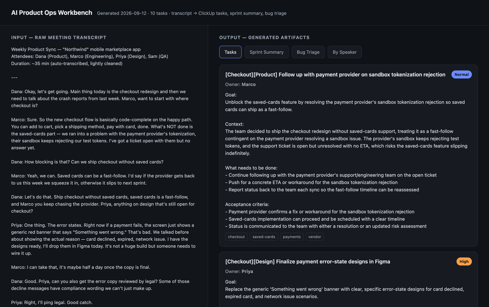

# AI Product Ops Workbench

Turn a messy meeting transcript into the artifacts a product team actually needs —
**ClickUp-ready tasks, a sprint summary, a bug triage table, and a per-speaker
breakdown** — in one command.

### **[▶ Live demo](https://natalie-chmurova.github.io/ai-product-ops-workbench/)** · [📄 Case study](CASE_STUDY.md) · [⚙️ n8n version](https://natalie-chmurova.github.io/ai-product-ops-workbench/n8n-case.html)

[](https://natalie-chmurova.github.io/ai-product-ops-workbench/)

Product teams lose hours turning call recordings and raw notes into structured work.
This tool does the boring part: it reads the transcript, figures out what was decided,
who owns what, and what's broken, then writes the documents for you.

```
transcript.txt  ─►  workbench.py ─►  ┌ tasks.json          (ClickUp-ready)
                                     ├ sprint_summary.md   (stakeholder update)
                                     ├ bug_triage.md       (QA triage table)
                                     ├ speaker_summary.md  (per-person: status, commitments, blockers)
                                     └ report.html         (input → output, one page)
```

## How it works

A small three-stage pipeline built on the [Claude API](https://console.anthropic.com):

1. **Understand** — read the raw transcript and extract a clean, structured summary
   (decisions, action items with owners, bugs, risks). One shared summary keeps every
   document consistent.
2. **Build** — turn that summary into the deliverables, each driven by its own
   prompt so the "product ops logic" is readable and easy to tune. The per-speaker
   view also reads the transcript directly, since who said what is the whole point
   of it — it answers "where is each person, who is stuck", which a thematic
   summary flattens away.
3. **Present** — render a single self-contained `report.html` showing the raw meeting
   on the left and the generated artifacts on the right. No server, just open it.

Prompts live in [`prompts/`](prompts/) as plain Markdown — the product logic is
first-class and editable without touching code.

**Board plan and apply (optional):** with `CLICKUP_API_TOKEN` set, the app lists the
workspace's ClickUp lists to pick from when `CLICKUP_TEAM_ID` is set, using
`CLICKUP_LIST_ID` as the default, and reads the chosen board before the first model
call; a fifth tab, **Board plan**, shows what the run would do to it — create, comment
on an existing task, or ask a human — with the agent's reason for each. The list is
chosen before you click Generate, and the plan is applied only to the list it was
reconciled against. One button applies that plan: new tasks are created titled,
prioritized, tagged and **assigned to the resolved owner**; matched points land as
comments carrying the meeting title and date. Items below the confidence gate are
applied only if you tick them, one by one. Every effect goes through the same
idempotency store the n8n workflow uses, so clicking twice applies nothing twice. Owner
names resolve via an alias map (`OWNER_ALIASES`) → fuzzy match on workspace members →
unassigned fallback.

## Run it

You need Python 3.9 or newer (tested on 3.9 and 3.11) and an
[Anthropic API key](https://console.anthropic.com). ClickUp is optional.

**Web app (point-and-click):**

```bash
pip install -r requirements.txt
cp .env.example .env          # then paste your Anthropic API key into .env
streamlit run app.py          # opens a browser: paste a transcript, click Generate
```

On macOS you can also just double-click `start.command` — it sets up the
environment on first run and launches the app.

**Command line (batch / scripting):**

```bash
python workbench.py samples/transcript_demo.txt   # a transcript...
python workbench.py samples/meeting_demo.m4a       # ...or an audio recording
python workbench.py samples/meeting_demo_full.m4a  # ...or the full 4-minute one
open outputs/report.html      # macOS ("xdg-open" on Linux)
```

Pass an audio/video file and it is transcribed locally first (mlx-whisper — nothing
leaves the machine, no per-minute API cost), then run through the same pipeline.
Audio is an optional install and works on Apple Silicon Macs only:

```bash
pip install -r requirements-audio.txt
brew install ffmpeg            # mlx-whisper decodes audio with it
```

Without them, transcripts work as before and an audio file gets a message saying what
to install. A full run over the demo transcript costs a few cents.

## Project layout

```
workbench.py        CLI entry point / orchestrator
src/
  client.py         talks to the Claude API (prompt loading, JSON parsing, retries)
  extract.py        stage 1 — transcript → structured summary
  artifacts.py      stage 2 — summary → tasks / sprint / bug triage / per-speaker
  render.py         stage 3 — artifacts → report.html
  reconcile.py      stage 1.5 — check each point against the board before acting
  plan.py           one effect per point, built once and read by every screen
  clickup.py        reads the board and writes to it
  apply.py          applies a plan to the board, each effect at most once
prompts/            the instructions for each stage (Markdown)
samples/            synthetic demo transcripts (no real/sensitive data)
evals/              the three eval harnesses, their labels and their results
outputs/            generated artifacts (git-ignored)
```

## Measuring it

Three harnesses, each answering a different question, all run against labels a
delivery manager validated by hand — and all of them allowed to fail.

| harness | question | latest |
|---|---|---|
| `evals/run_eval.py` | was the work found? | recall 100%, precision 100% on three transcripts |
| `evals/eval_decisions.py` | new work or an update to something that exists? | 100% decision, 100% target |
| `evals/eval_effects.py` | what should actually happen to the board? | 64% / 67% / 50% |

The third is deliberately red, and it is why nothing is written to a board without a
person clicking Apply: three of its ten misses are real errors of judgement. What the
numbers are made of, what a messy board costs, and why the gate stays closed are in the
[case study](CASE_STUDY.md#measuring-it).

## Notes

- The demo transcript is **synthetic** — a fictional team and product, safe to share.
- Task descriptions follow a real ClickUp ticket structure
  (Goal / Context / What needs to be done / Acceptance criteria).
- Built as a portfolio project demonstrating AI-assisted product operations.
- Licensed under [MIT](LICENSE).
